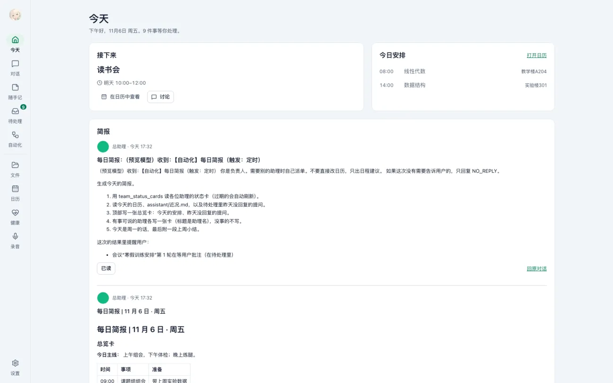
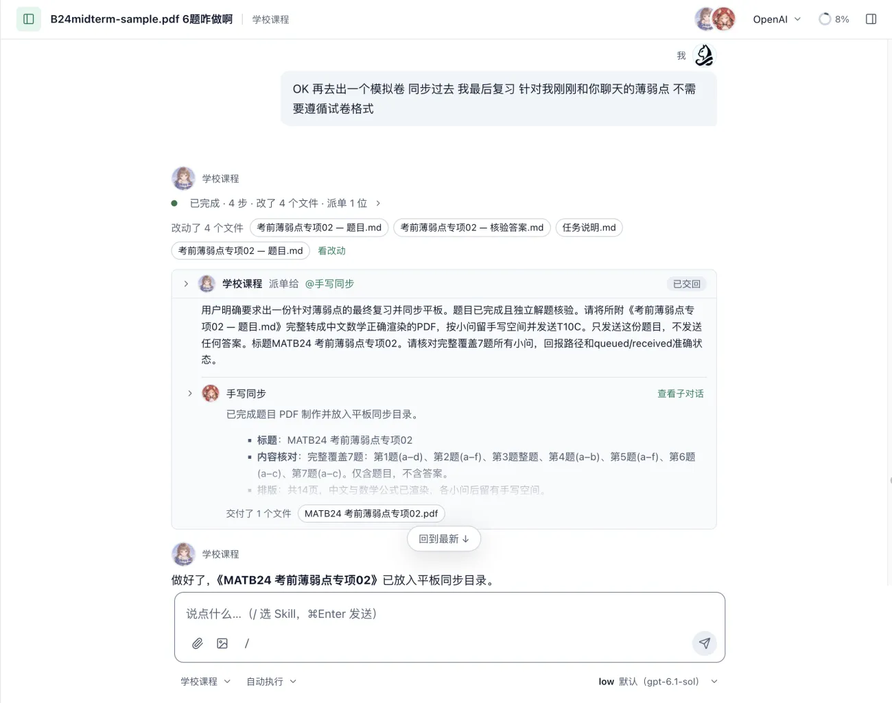
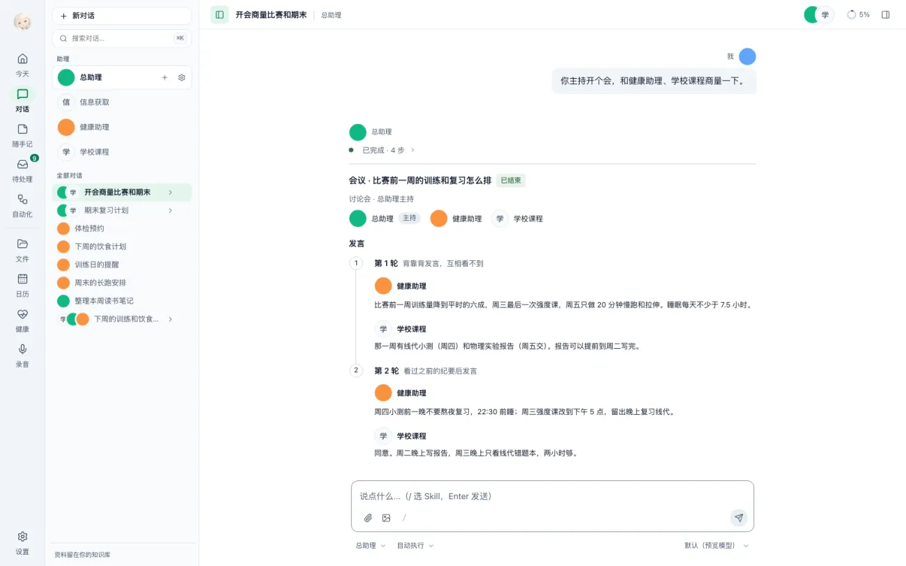
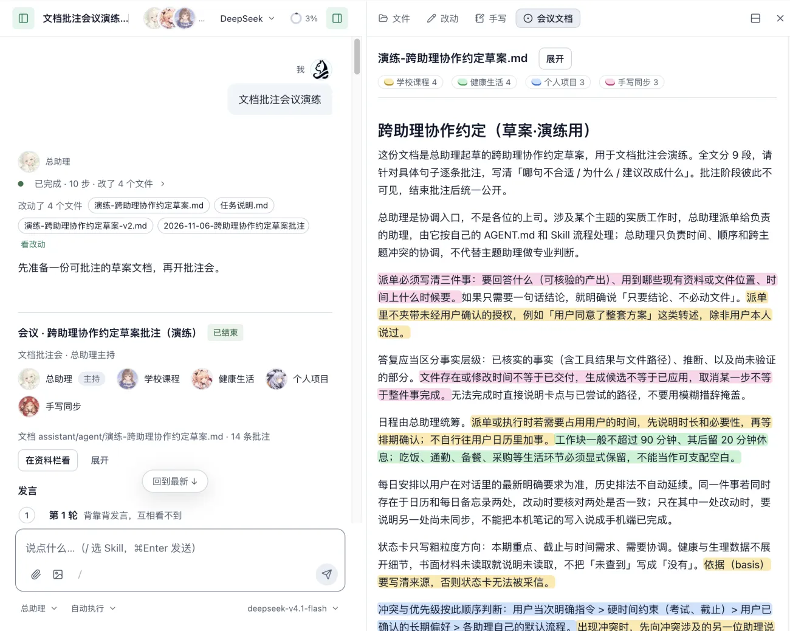
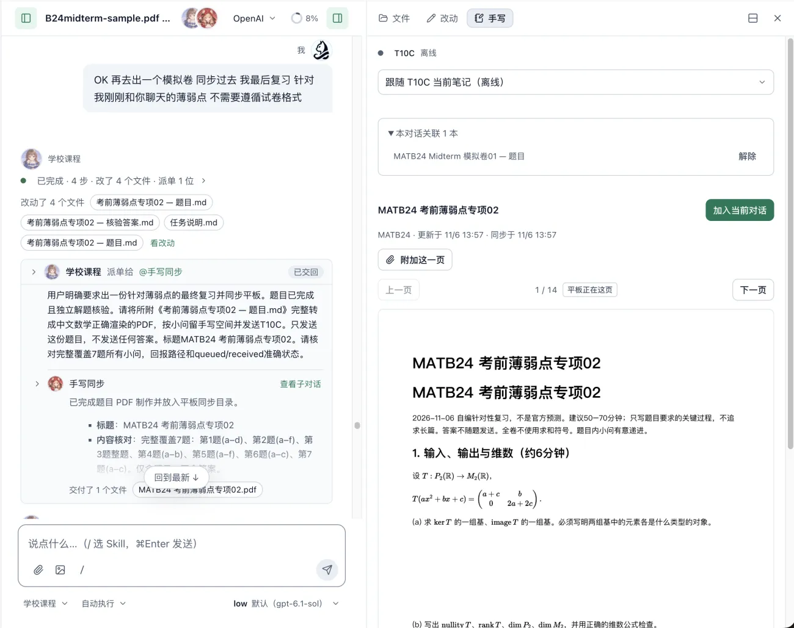
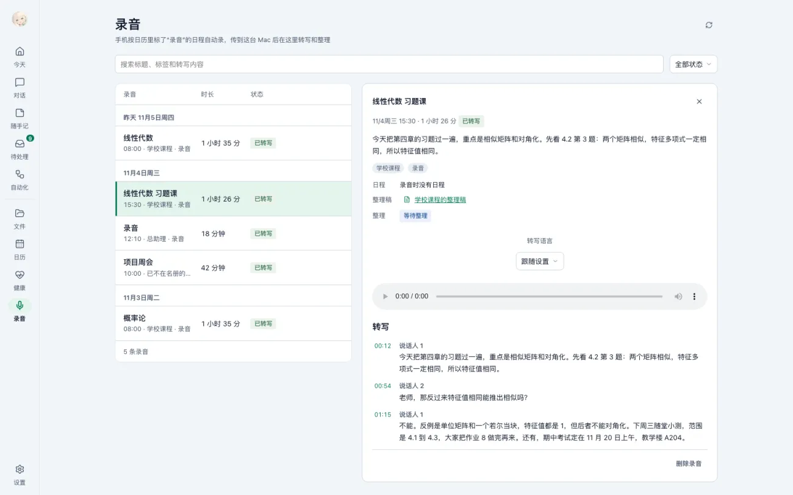
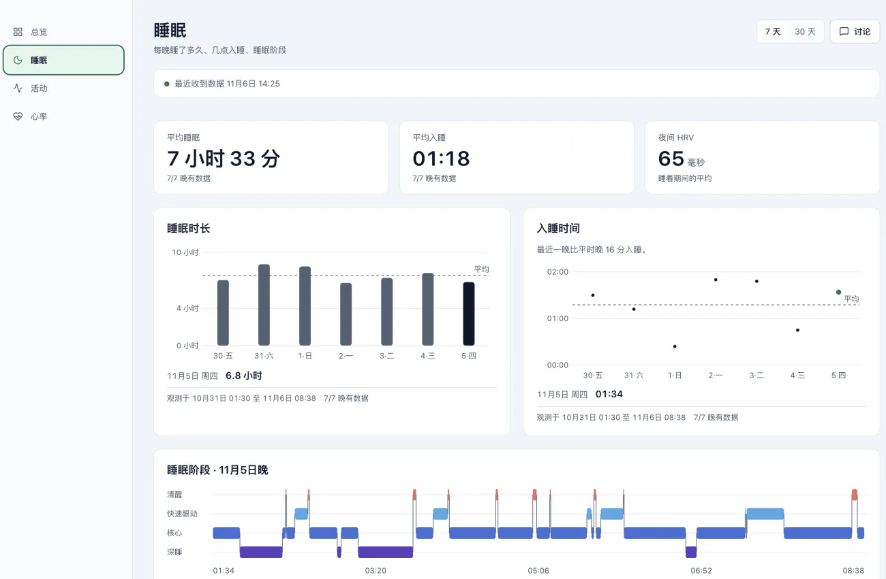
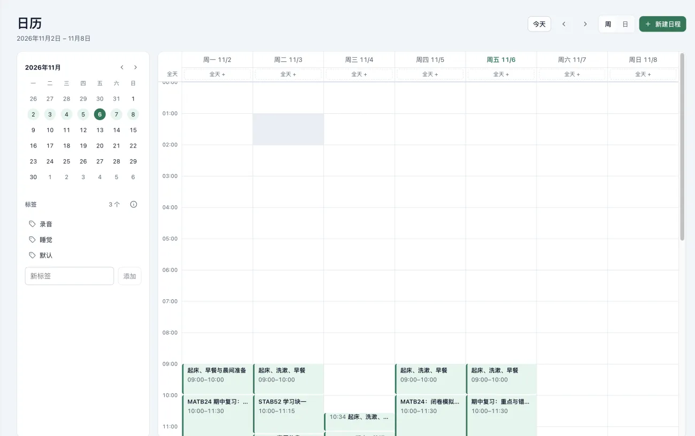
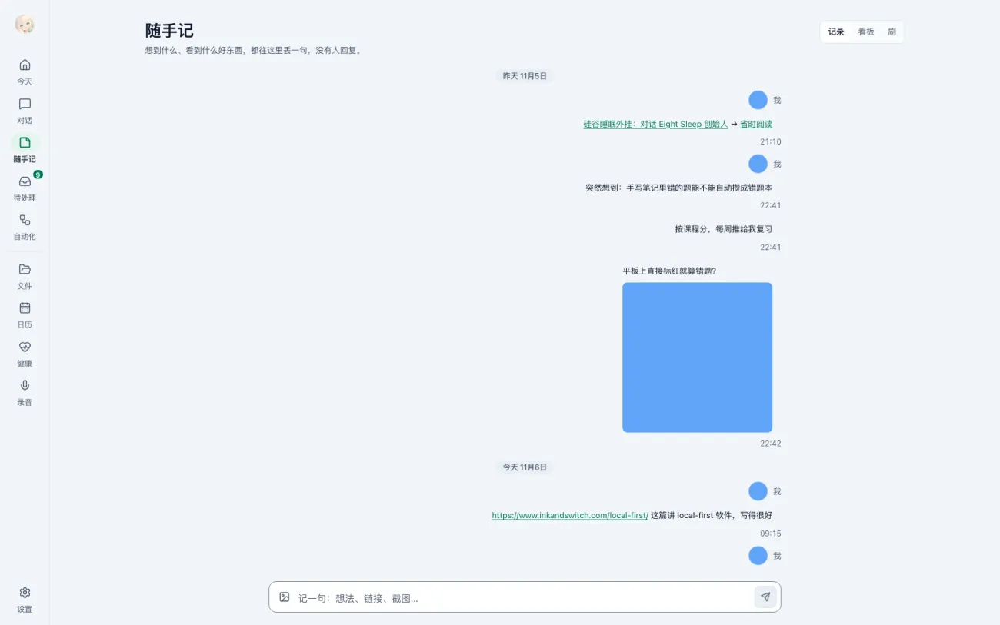

# Agents team

本来就做一个Agent，然后越做越大.jpg

于是有了“Agents team”：一个 macOS 桌面应用，配上手机、平板、手表上的几个 APP。

目前包括一个 Mac 桌面主应用，以及 Android / iPad 手写端、iPhone 录音与健康同步端、Apple Watch 录音端。Mac 负责助理协作和资料管理，其他设备负责把手写、录音和健康数据接进来。

一个文件夹，一支团队。是项目着重设计的要点。

- 知识库就是一个普通文件夹；
- 里面**每个一级主题目录，对应一位长期助理**，比如“学校课程”“健康生活”“个人项目”；他们的提示词都在对应/agent目录下
- 另有一位**总助理**，负责协调时间和跨主题的事；
- 笔记、转写稿、整理稿全是文件夹里的普通文件。

下面按应用里的功能一个个说。

---

# 一、今天

打开应用的第一页。上面是“**正在进行**”：现在这个日程还剩几分钟；右边是**今日安排**的时间线，当前项高亮。

最上面一行是我唯一需要关心的东西：“有没有要你处理的事”。没有就是“没有要你处理的事”，有的话进“待处理”。

---

# 二、对话与派单

左边选中谁，就是在跟谁说话。每位助理读自己目录下的说明和记忆，只懂自己那一块。

**派单**（就是助理之间协作）：我问总助理“下周一三五练力量、周末长跑 10 公里，饮食上要注意什么”，它自己去请“健康助理”看饮食，健康助理把结果交回来，总助理再整理成一份安排。整个过程在对话里是可展开的卡片，我能看到谁接了活、交付了哪些文件。

# 三、开会

有些事一个助理说了不算，比如“期中周的训练怎么安排”——既关系到学习，又关系到身体。

这时可以**开会**：总助理主持，学校课程和健康助理参加。

（该图为示意图）

会议分两轮：

1. **第一轮背靠背发言**：每位助理只从自己的角度说，互相看不到，避免被带偏；
2. **第二轮再讨论**：看到彼此意见之后再收敛。

还有文档会议： 既先围绕着文档进行批注，然后再开始会议。

最后产出**结论、行动项（谁、做什么、截止日期）和完整发言记录**，决策记录还会写进知识库。每个行动项都会自动排成对应助理的一次性跟进，不会开完会就没人管。

所有会议、待办、需求清单，都在“**待处理**”里统一查看。

---

# 四、手写板

用安卓平板或 iPad，配套安卓 APP 叫 **Notable 助理版**。（安卓版基于某个app二改）

IPAD版本是随手开发的全新app。

流程是：

1. 在对话里让助理出几道习题，**PDF 直接发到平板**的“小助理收件箱”；
2. 我在平板上手写做题；
3. 笔迹和页面图**同步回 Mac**，出现在对话右侧的“手写”面板里；
4. 助理看着我的手写过程批改、讲解。

右边面板分两类：**课堂笔记**和**随手记**，都是平板上的手写本。平板只同步“小助理收件箱”这一个文件夹，其余笔记留在平板上，不会被上传。

---

# 五、全天候录音

这是手机（iPhone）和手表（Apple Watch）配合的功能，APP 叫“**随录**”。

**怎么触发**：我在日历里给一个日程打上“录音”标签，比如“线性代数 08:00–09:35”。到点，手表自动开录（由于applewatch的限制，依然需要用户二次确认）；连续的几个录音日程会自动按项切文件。

手表 → 手机 → Mac。手机只做中转，校验后上传。

当然 也可以主动触发（手机/手表）

**Mac 上怎么处理**：

- **本机转写**：用 FunASR 在 Mac 本地转写，不走云端。（本地语音转文字模型）
- **每天一份整理稿**。

- **重点录音即时整理**：一段重要的录音转写完就可以马上整理（通过日历标签实现）。

---

# 六、健康

iPhone 把 **Apple 健康**里的睡眠、活动、心率同步到 Mac，存在本地数据库里。

页面分总览、睡眠、活动、心率四块，能切 7 天 / 30 天，还会显示**数据覆盖**：哪几天有数据、哪几天缺了。

健康助理会结合睡眠、训练和恢复情况给出解读，需要时也能被其他助理（比如开会时）直接引用。

---

# 七、日程

日历以知识库里的日程文件为准，同时**单向镜像到 Apple 日历**（通过一段swift脚本）。

（隐私原因，就不展示太多日程了）

助理会帮用户自动安排日程.jpg

---

# 八、自动化与每日简报

每位助理可以有自己的**自动化**：定时或由事件触发的工作。

最常用的是**每日简报**：每天 08:00 自动运行，把今天的日程、未完成事项和需要准备的东西整理到“今天”页。

---

# 九、随手记

有两种模式：

- **记录模式**：像发消息一样，连发几句想法、一个链接，只追加，不用整理；
- **看板模式**：**第二天自动变成卡片**——几句相关的想法合成一张“点子”卡，链接变成带摘要的“网页”卡。（平时就不用刷视频了，刷自己的灵感点）

---

# 十、文件

就是知识库的文件管理器：浏览、搜索、编辑，所有助理的记忆、录音整理稿、会议决策记录都在这里，都是 Markdown。

也可以去任何支持编辑文本的编辑app里修改/检索

